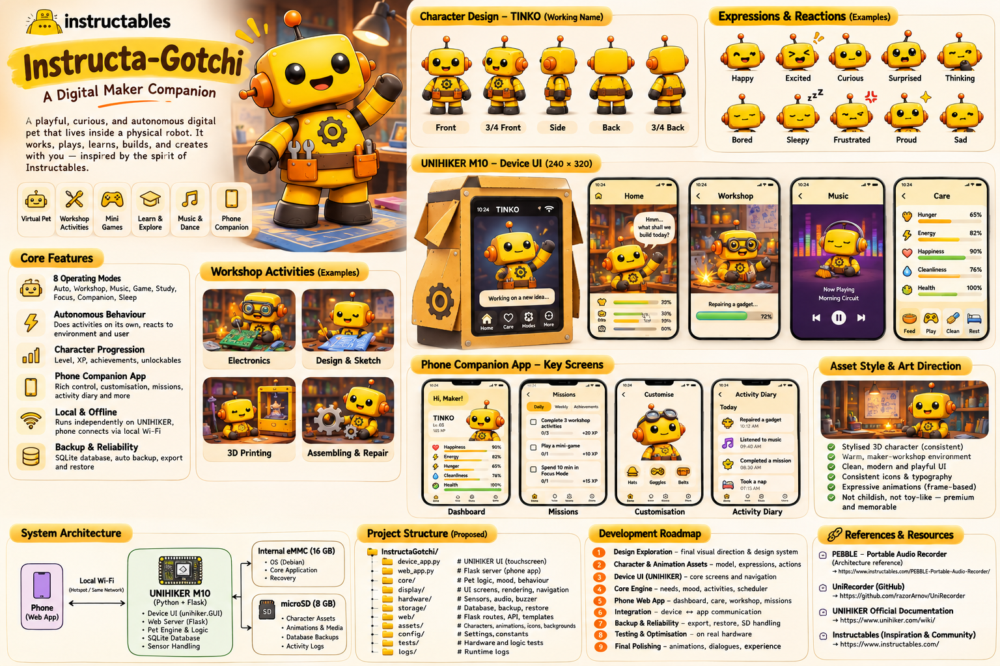
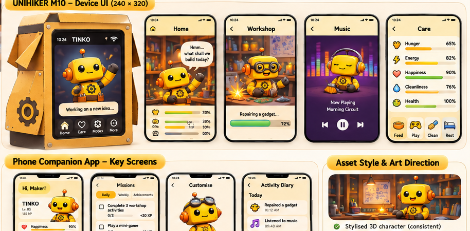
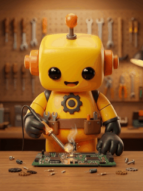
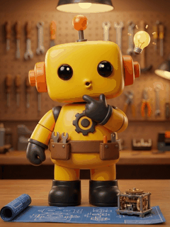
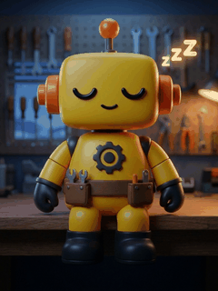
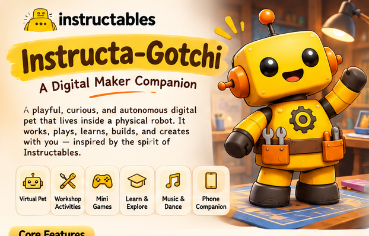
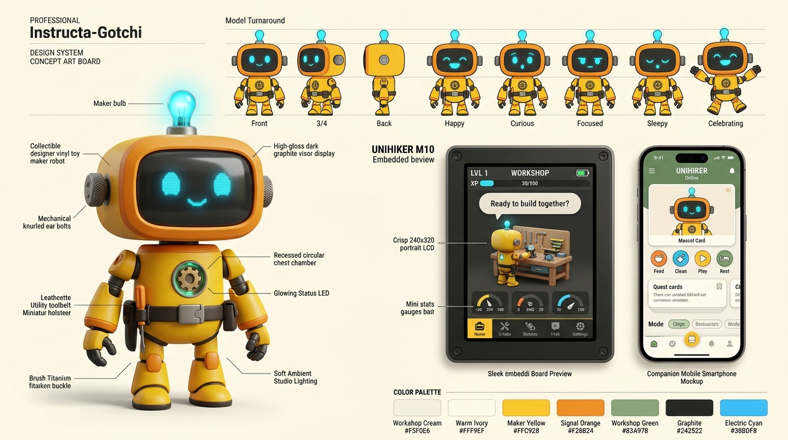

# Instructa-Gotchi: TINKO Maker Companion

Instructa-Gotchi is a physical virtual pet and maker companion built for the DFRobot UNIHIKER M10 single board computer. The project pairs an autonomous character display living on the device screen with a full-featured robot Tamagotchi dashboard accessible from any phone browser on the same Wi-Fi network.



---

## The System Architecture

The core design principle of Instructa-Gotchi is a strict separation between the device display and the user interface. 

The physical UNIHIKER M10 features a 2.8 inch portrait touchscreen running Rockchip ARM Linux. Rather than crowding this compact screen with buttons, health bars, and menus, the display acts purely as a living window into Tinko's workshop. Tinko works autonomously at his workbench, cycles through tasks, solders circuits with visible sparks, drafts schematics under a warm desk lamp, listens to workshop tunes, and takes naps when his battery is low. The screen contains zero HUD elements, zero buttons, and zero text overlays.

All interactive controls, battery charging levers, gear maintenance tools, minigames, crafting benches, and telemetry monitors live inside the Phone Companion Web App hosted directly by the UNIHIKER on port 8088.



---

## UNIHIKER Display: Living Character Animations

On the physical hardware, the display renderer cycles through multi-frame sprite sequences at 4 frames per second to ensure smooth character motion while conserving CPU and battery power. Tinko operates on an internal activity scheduler that switches tasks every 6 to 14 seconds.

| Soldering Circuit | Workshop Jam | Blueprint Drafting | Low-Power Sleep |
| :---: | :---: | :---: | :---: |
|  |  |  |  |

Tapping anywhere on the physical UNIHIKER touchscreen triggers a gentle affection reaction. Tinko perks up, waves his arms, gains 5 XP, and returns to his workshop tasks without interrupting his schedule.

---

## Phone Companion Web App

The phone app transforms the companion into a full robot Tamagotchi experience. It is accessed by browsing to `http://<UNIHIKER_IP>:8088` from your smartphone.



### 1. High-Voltage Power Dock
Because Tinko is a robotic maker pet, feeding is handled through a realistic power cradle. The Power Dock tab provides an interactive docking lever that latches Tinko into charging mode. The dashboard displays live LiPo battery voltage (scaling from 3.60V empty to 4.20V fully charged), active charging current (1.20A fast charge), and battery cell health. Users can choose between USB-C Turbo Boost, an Inductive Wireless Pad, and a Solar Array trickle charge.

### 2. Tune-Up Bay & Thermal Management
Traditional pet hygiene is reimagined as mechanical maintenance. Users can degrease and lubricate joint gears with Teflon oil, torque chassis screws to 0.8 Nm to calibrate servo alignment, apply fresh diamond thermal paste, and run comprehensive bus diagnostics. When Tinko solders intensely, his internal temperature rises; users can toggle the high-speed turbine cooling fan to bring core temperatures back down to safe operating levels.

### 3. Built-In Maker Minigames
The companion includes two playable games that directly affect Tinko's stats and drop collectible crafting components.
* Circuit Wire Splicer: A 15-second timed puzzle where players connect matching terminal pairs (+5V VCC, GND, PWM Signal, and I2C Clock) across a breadboard. Successful circuits award XP, restore battery, and drop salvaged parts.
* Workshop Rhythm Beat: A musical timing game where players tap the strike pad when gear notes align with the laser guide, building combo multipliers and boosting happiness.

### 4. Parts Drawer & Crafting Bench
Winning minigames and completing daily maker quests drops six core electronic components: 10kΩ resistors, RGB LEDs, brass gears, rosin solder wire, 555 timer ICs, and induction coils. Players can combine these parts at the crafting bench to build permanent workshop gear such as the Titanium Solder Wand, Dual LED Worklight, and Turbine Heatsink, each triggering celebratory animations on the UNIHIKER screen.

### 5. Remote Workshop Director
Users who want to direct Tinko manually can send immediate commands over Wi-Fi. Pressing Order Soldering, Workshop Jam, Draft Blueprints, or Power Down Sleep commands the UNIHIKER screen to switch immediately to that animation. The panel also includes eight operating mode selectors (Auto, Workshop, Music, Game, Study, Focus, Companion, and Sleep).

### 6. Firmware Upgrades
As Tinko completes builds and earns experience points, the Firmware Bay allows users to flash new firmware revisions (such as updating from v1.0.4 "Spark Boot" to v1.2.0 "Gear Mesh" and v2.0.0 "Circuit Weaver"), upgrading hardware capability and increasing maximum capacity.

---

## Design System and Palette

The user interface follows the physical maker workshop aesthetic established in the project design guidelines. It uses a warm parchment and ivory canvas accented with maker yellow, signal orange, and industrial graphite.



* Background: Workshop Cream (`#F5F0E6`) with a subtle radial amber dot grid.
* Surfaces: Warm Ivory (`#FFF9EF`) and Workshop Card (`#FFFDF8`) bordered with amber lines (`#FDE68A`) and soft drop shadows.
* Primary Brand Accents: Maker Yellow (`#FFC928`) and Signal Orange (`#F28B24`).
* Telemetry Status Colors: Electric Cyan (`#38BDF8`) for thermals and cooling, Workshop Green (`#83A978`) for lubrication and health, and Warm Coral (`#ED735C`) for alerts.
* Typography: Fredoka for headings and tactile buttons, paired with Plus Jakarta Sans for body copy and JetBrains Mono for telemetry metrics.

---

## File Structure

```
doc/instructgotchi/
├── run.py                     Unified launcher for device app and web companion
├── device_app.py              UNIHIKER 240x320 portrait living character loop
├── web_app.py                 Dedicated web companion entry point (Port 8088)
├── config/
│   ├── settings.py            Hardware, microSD discovery, and network settings
│   └── design_tokens.json     Dimensions, color tokens, and animation timings
├── core/
│   ├── pet_state.py           Central state coordinator (needs, leveling, activities)
│   ├── needs.py               Battery decay, charging logic, and care action handler
│   ├── mood.py                Emotional state evaluator (15 distinct moods)
│   ├── personality.py         Maker voice line generator and context responses
│   ├── activity_engine.py     Autonomous workshop scheduler and task switcher
│   └── animation_controller.py Paced frame sequencer for 240x320 animations
├── display/
│   ├── renderer.py            Hardware unihiker GUI wrapper with software buffer
│   ├── living_screen.py       Zero-HUD living workshop character renderer
│   ├── screens.py             Renderers for preview and diagnostic screens
│   └── navigation.py          Touch target hitbox and navigation manager
├── storage/
│   ├── database.py            SQLite persistence layer with WAL mode enabled
│   └── backup.py              Atomic backup creator and database integrity verifier
├── web/
│   ├── routes.py              REST API endpoints and standalone HTTP request handler
│   └── templates/
│       ├── index.html         Mobile companion web application
│       ├── simulator.html     Virtual UNIHIKER screen simulator
│       └── design_system.html Design token inspector and reference sheet
├── assets/
│   ├── animations/            Multi-frame character animations (soldering, dancing, etc.)
│   ├── scenes/                Static 240x320 fallback workshop scene backgrounds
│   ├── characters/            Character avatar icons and turnaround sheets
│   └── icons/                 Maker tool, part, and status icons
├── docs/
│   └── images/                Documentation diagrams, screenshots, and animation previews
└── tests/
    └── test_instructgotchi.py Unit test suite verifying database, API, and rendering
```

---

## Installation & Running

### Prerequisites
The UNIHIKER M10 runs Debian Linux with Python 3.7.3. The standard packages `unihiker`, `Pillow`, `sqlite3`, and `requests` are preinstalled on the official operating system image.

### Running on UNIHIKER M10
To launch both the device screen and the mobile companion server:
```bash
python3 run.py
```

To run individual components separately:
```bash
python3 run.py --device    # UNIHIKER screen only
python3 run.py --web       # Phone web companion only
```

### Auto-Start on Boot
On the UNIHIKER, the native system service manages the main display application:
```bash
systemctl --user restart PyboardUI
```
PyboardUI automatically detects and runs `/root/InstructGotchi/run.py` on display `:0.0`.

### Running Tests
To verify database persistence, needs decay, API routing, and screen rendering:
```bash
python3 -m unittest discover -s tests
```

---

## REST API Reference

The phone companion communicates with the UNIHIKER using local HTTP REST endpoints:

* `GET /api/state` returns the full pet status including battery level, voltage, core temperature, current activity, mood, and firmware level.
* `POST /api/charge` accepts actions `dock_toggle`, `fast_charge`, or `trickle_charge` to control power cradle charging.
* `POST /api/maintenance` accepts actions `oil_gears`, `tighten_chassis`, `fan_toggle`, `thermal_paste`, and `run_diagnostics`.
* `POST /api/minigame` records game completion with score, awarding experience points, happiness, and dropping random maker parts.
* `GET /api/parts` returns the current count of all maker inventory parts.
* `POST /api/craft` crafts recipes by consuming parts and unlocking new robot capabilities.
* `POST /api/command` sends direct directives (`solder`, `dance`, `think`, `sleep`, `pet`) to the physical screen.
* `POST /api/mode` switches between the eight operating modes.
* `GET /api/missions` retrieves daily maker quests and progress.
* `GET /api/diary` retrieves the recent chronological activity history.
